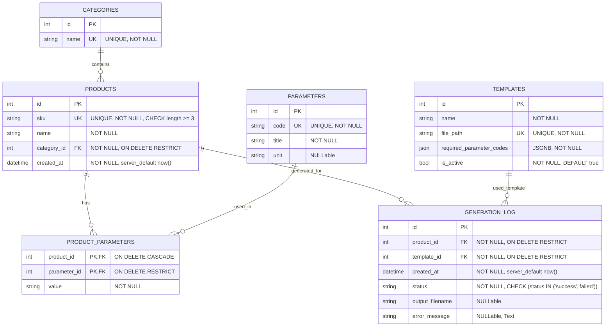

# 🗄 ER-диаграмма базы данных (Entity-Relationship Diagram)

Данная схема описывает структуру реляционной базы данных сервиса генерации паспортов изделий на PostgreSQL.

---

## Графическая диаграмма связей (Mermaid)

---

## Описание сущностей и типов связей

1. **`categories` $\rightarrow$ `products` (Один-ко-многим / 1:M)**  
   Каждое изделие строго принадлежит одной категории (Блоки питания, ИК-прожекторы, Прожекторы видимого света).
2. **`products` $\leftrightarrow$ `parameters` через `product_parameters` (Многие-ко-многим / M:M)**  
   Ассоциативная таблица со связкой `(product_id, parameter_id)` и текстовым полем `value`. Позволяет задавать произвольный состав технических характеристик без денормализации.
3. **`products` $\rightarrow$ `generation_log` (1:M) и `templates` $\rightarrow$ `generation_log` (1:M)**  
   Журнал аудита генераций. Каждая запись связывает изделие, использованный шаблон, статус операции (`success`/`failed`), имя сформированного файла и возможную ошибку.

---

## Ограничения целостности и индексы
* **Ограничения CHECK:**
  * `check_product_sku_min_length`: `length(sku) >= 3`
  * `check_generation_log_status`: `status IN ('success', 'failed')`
* **Ограничения внешних ключей (FK):**  
  Все внешние ключи, связывающие историю генераций с изделиями и шаблонами, имеют режим **`ON DELETE RESTRICT`**, защищая историю аудита от случайного удаления изделий.
* **Индексы для производительности:**
  * `idx_products_sku` — быстрый поиск изделий по заводскому артикулу;
  * `idx_products_category` — быстрая фильтрация по категории;
  * `idx_generation_log_created` — выборка для правила дедупликации (окно 10 минут) и построения аналитических отчетов;
  * `idx_product_parameters_product` — быстрая сборка характеристик изделия при рендеринге документа.
